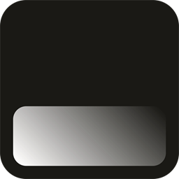
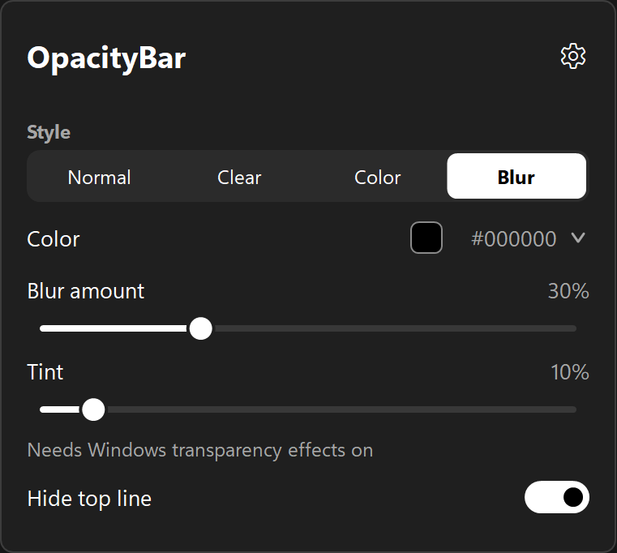

<div align="center">

<picture>
  <source media="(prefers-color-scheme: dark)" srcset="docs/images/logo-white.png">
  
</picture>

# OpacityBar

**Make the Windows taskbar clear, colored or blurred.**
A small, open-source tray app for Windows 11 and 10.

[](https://github.com/mollerstudio/OpacityBar/actions/workflows/build.yml)
[](https://github.com/mollerstudio/OpacityBar/releases/latest)
[](LICENSE)

[**Download**](https://github.com/mollerstudio/OpacityBar/releases/latest) · [Changelog](CHANGELOG.md) · [Report a bug](https://github.com/mollerstudio/OpacityBar/issues/new/choose)



</div>

---

## Features

- **Four styles, one click.** *Normal* (the standard Windows taskbar), *Clear*, *Color* and *Blur*.
- **Any color.** A built-in picker with hex input, quick swatches and your recent colors, plus an opacity slider.
- **Adjustable blur.** A real blur of what's behind the taskbar, with a strength slider and an optional tint.
- **Only the background changes.** Icons, text and the clock stay crisp and fully opaque. Clear is really 100% clear.
- **Out of your way.** Lives in the tray, follows the Windows light/dark theme (the tray icon too), and starts with Windows if you want.
- **Light and safe.** Under 1 MB, no admin rights, no network access, no telemetry. Quitting restores the normal taskbar.

## Install

1. Download **`OpacityBar-<version>-Setup.exe`** from the [latest release](https://github.com/mollerstudio/OpacityBar/releases/latest).
2. Run it and click **Install**. Running a newer setup later updates your copy in place.

The installer installs for your account only (to `%LocalAppData%\Programs\OpacityBar`), so it needs no admin rights. Uninstall from **Settings > Apps > Installed apps**.

> **SmartScreen:** OpacityBar is not code-signed yet, so Windows may say it "protected your PC". Click **More info > Run anyway**. You can check the download against `SHA256SUMS.txt` from the release.

**Portable:** prefer no installer? Download `OpacityBar-<version>-Portable.zip`, unzip it anywhere and run `OpacityBar.exe`. To keep the settings next to the exe, add an empty file named `portable` to the folder.

## Use

- **Left-click** the tray icon to open OpacityBar and pick a style.
- **Right-click** it for a quick menu.
- The **gear** opens settings: start with Windows, light/dark theme, reset, quit.
- **Ctrl + Shift + Alt + Q** quits instantly and restores the normal taskbar.

> **Help wanted: tell us how it runs on your PC.** OpacityBar is tested on Windows 11 ARM64. Normal x64 PCs and
> Windows 10 should work but haven't been confirmed yet. If you try it, please
> [report how it went](https://github.com/mollerstudio/OpacityBar/issues/new/choose), even if everything works.
> If anything looks wrong, **Quit** (or Ctrl+Shift+Alt+Q) puts the normal taskbar back right away.

**Requirements:** Windows 11 (any version) or Windows 10, x64 or ARM64. The .NET Framework 4.8 it uses is built into Windows. On Windows 10, Clear/Color/Blur use the classic transparency API.

## How it works

On Windows 11 the taskbar is drawn with XAML inside `explorer.exe`, and its background can't be changed from outside. OpacityBar loads a tiny helper ([`native/OpacityBarTAP.cpp`](native/OpacityBarTAP.cpp)) into Explorer with Microsoft's official **XAML Diagnostics API** (`InitializeXamlDiagnosticsEx`), the same API Visual Studio's Live Visual Tree and TranslucentTB use.

The helper:

- changes only the taskbar's background rectangles (`BackgroundFill` / `BackgroundStroke`): their opacity, their brush, or a blur brush drawn by the system compositor;
- receives a small text document of style rules from OpacityBar ([protocol](native/PROTOCOL.md));
- puts the original Windows brushes back when you choose Normal or quit;
- does **not** use the network, write files or the registry, hook input, or read anything on screen.

Because it loads code into another process, some antivirus tools may flag it. The full source is here to audit: one commented C++ file for the helper and a few C# files for the app.

### Privacy

OpacityBar collects nothing and has no network code. [PRIVACY.md](PRIVACY.md) lists every file and registry
entry it touches.

| | |
| :--- | :--- |
| Network | None. No telemetry, analytics or update checks. |
| Admin rights | Never (`asInvoker`). |
| Settings | `%AppData%\OpacityBar\settings.json` |
| Start with Windows | `HKCU\...\CurrentVersion\Run\OpacityBar`, only when enabled |
| Logs | None, unless you start it with `--diagnostics` |

<details>
<summary><b>Command line</b></summary>

| Switch | Effect |
| :--- | :--- |
| `--minimized` | Start in the tray without opening the window (used by "Start with Windows") |
| `--quit` | Ask a running OpacityBar to quit and restore the taskbar |
| `--uninstall [--silent]` | Remove the installed copy (what Settings > Apps runs) |
| `--diagnostics` | Write a local log to `%LocalAppData%\OpacityBar\opacitybar.log` and show "Save taskbar map..." |

`OpacityBar-<version>-Setup.exe /silent` installs or updates without any window.
</details>

## Build from source

The app and installer build with the C# compiler that ships with Windows. No Visual Studio needed:

```powershell
.\build.ps1
```

This produces `dist\OpacityBar.exe`, and `dist\OpacityBarSetup.exe` when both helper DLLs are in `dist\`. The helper DLLs need MSVC with the Windows SDK. [GitHub Actions](.github/workflows/build.yml) builds everything on every push. See [CONTRIBUTING.md](CONTRIBUTING.md) for details and the release process.

```text
src/          the app: tray, flyout UI, taskbar engine, helper loader (C#, .NET Framework 4.8)
installer/    the installer window (shares the app's UI code)
native/       the Explorer helper (C++), its exports and protocol
assets/       icons and logo picked up by the build
docs/         images for this README
```

## License

The code is [MIT](LICENSE) © 2026 [moller.studio](https://moller.studio). The OpacityBar name and logo are not
covered by the MIT license; see [TRADEMARKS.md](TRADEMARKS.md). Contributions are welcome under the same license
([CONTRIBUTING.md](CONTRIBUTING.md), [Code of conduct](CODE_OF_CONDUCT.md)).

Built by [moller.studio](https://moller.studio) with AI-assisted development (Claude). All code is reviewed, tested
and open for anyone to audit. OpacityBar is an independent project, not affiliated with Microsoft.
